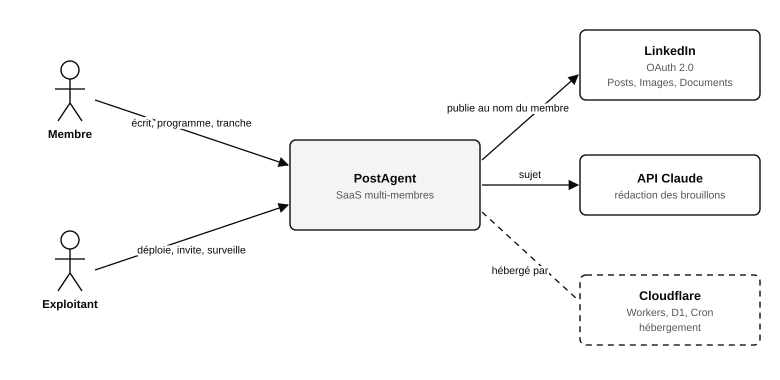
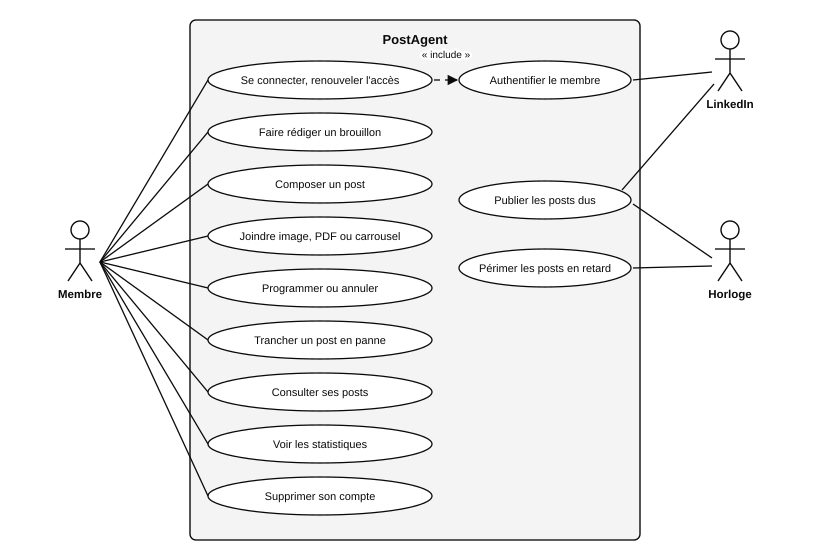
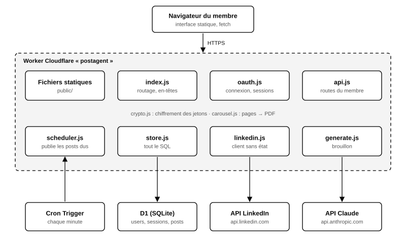
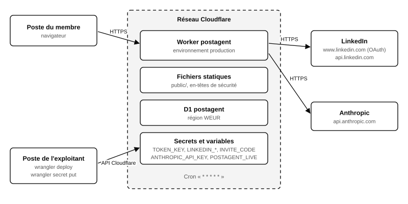
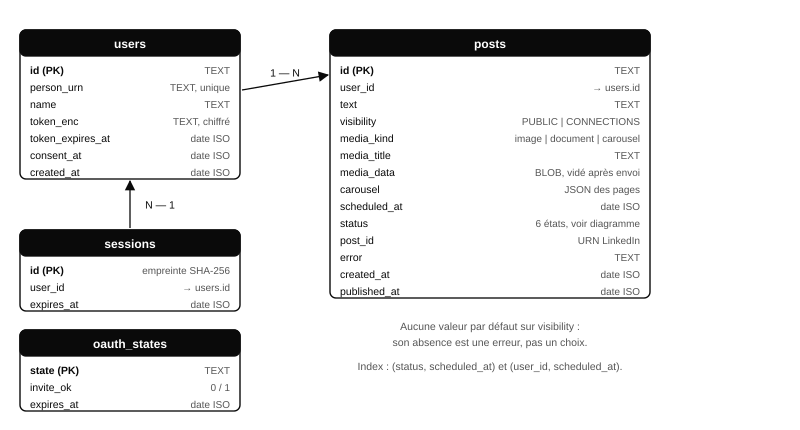
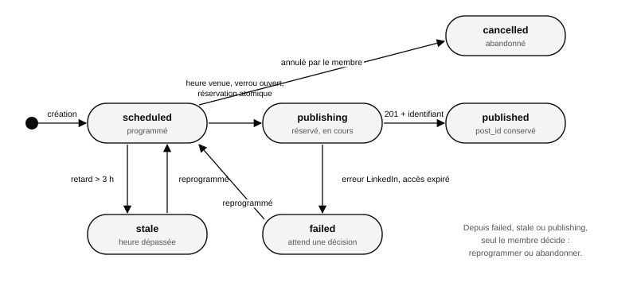
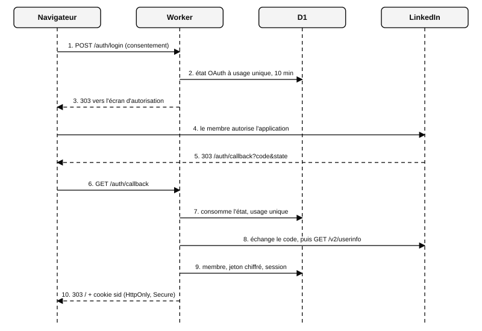
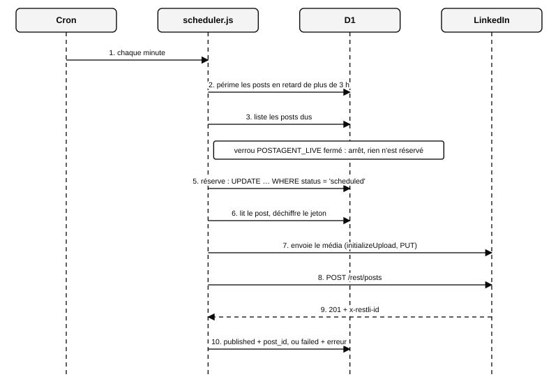
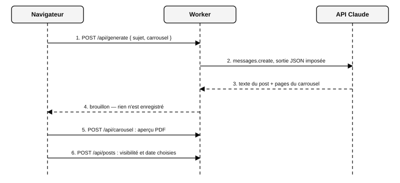

# Cahier des charges — PostAgent, SaaS multi-membres

Ce document décrit ce que PostAgent doit faire en tant que service en ligne
partagé, pourquoi, sous quelles contraintes, et comment il est conçu. Il
distingue partout ce qui est **construit et testé**, ce qui est **construit
mais jamais éprouvé en conditions réelles**, et ce qui **reste à faire**.

| | |
|---|---|
| Version | 1.0 — 12 octobre 2026 |
| Statut | Première tranche construite sur la branche `chantier/saas` ; non déployée |
| Commanditaire | Alan Tchapda, Sentinelle Services |
| Code de référence | dossier `saas/` du dépôt `PostAgent` |
| Documents liés | `files/PRODUIT.md` (décisions, lecture des conditions LinkedIn), `saas/README.md`, `GUIDE_UTILISATEUR.md` |

## 1. Objet et contexte

### 1.1 Objet

PostAgent permet à un professionnel de préparer et de publier ses posts
LinkedIn sans y passer : il donne un sujet, relit un brouillon, y joint un
visuel, choisit l'heure et la visibilité. Le service publie à l'heure dite
et garde la trace de ce qui est parti.

La cible de ce cahier est la version **multi-membres** : plusieurs
personnes utilisent la même installation, chacune sur son propre profil
LinkedIn, sans rien installer.

### 1.2 Existant

Une première version, personnelle, est en service depuis septembre 2026.

| | Instance personnelle (existante) | SaaS (objet de ce document) |
|---|---|---|
| Utilisateurs | un seul, technique | plusieurs, non techniques |
| Interface | une conversation avec un assistant, sur son poste | une interface web |
| File de publication | fichiers JSON dans git | base de données |
| Exécution | GitHub Actions, déclenché par une horloge externe | Worker Cloudflare, tâche chaque minute |
| Accès LinkedIn | un jeton dans un secret GitHub | un jeton chiffré par membre |
| Contenus | texte seul | texte, image, PDF, carrousel |

L'instance personnelle reste en service. Elle a livré les règles que le
SaaS reprend telles quelles, chacune issue d'une mesure ou d'un incident :
échappement du texte, comptage en unités UTF-16, visibilité sans valeur par
défaut, réservation avant publication, absence de nouvel essai automatique,
verrou de publication fermé par défaut.

### 1.3 Périmètre

**Dans le périmètre**

- connexion par LinkedIn, inscription sur invitation ;
- rédaction assistée d'un post et d'un carrousel à partir d'un sujet ;
- post texte, avec image, avec PDF, avec carrousel généré ;
- programmation, annulation, publication à l'heure, arbitrage des échecs ;
- statistiques d'un post, quand LinkedIn les autorise ;
- suppression de son compte et de ses données par le membre.

**Hors périmètre de cette version**

- vidéo, images générées par IA, pilotage depuis un assistant (serveur MCP
  distant), facturation : prévus, non construits (voir section 12) ;
- pages entreprise : autre API, soumise à approbation ;
- modification du profil (titre, expériences) : aucune API ne le permet ;
- toute lecture du réseau, des messages ou des posts d'autrui ;
- tout contournement de l'API officielle (extraction de pages, automatisation
  de navigateur) : interdit, sans exception.

### 1.4 Glossaire

| Terme | Sens dans ce document |
|---|---|
| Membre | personne inscrite, qui publie sur son propre profil LinkedIn |
| Exploitant | celui qui déploie et surveille le service (Sentinelle Services) |
| Jeton | jeton d'accès OAuth délivré par LinkedIn pour un membre, valable deux mois |
| URN | identifiant LinkedIn d'un membre, d'un post ou d'un média (`urn:li:…`) |
| Carrousel | document PDF de plusieurs pages, que LinkedIn affiche page par page |
| Verrou de publication | variable `POSTAGENT_LIVE` : sans elle, rien ne part vers LinkedIn |
| Trancher | décision du membre sur un post qui n'est pas parti comme prévu |
| Worker | programme exécuté par Cloudflare à chaque requête ou à chaque minute |
| D1 | base de données SQLite gérée par Cloudflare |

## 2. Analyse du besoin

### 2.1 Acteurs

| Acteur | Rôle | Attente principale |
|---|---|---|
| Membre | écrit, programme, tranche | publier régulièrement sans y penser, sans jamais être surpris par ce qui part |
| Exploitant | déploie, invite, surveille | un service qui ne publie rien d'inattendu et dont chaque panne se voit |
| LinkedIn | authentifie, reçoit les posts | respect de ses conditions d'utilisation |
| API Claude | rédige les brouillons | — |
| Horloge (Cron) | réveille le service chaque minute | — |

### 2.2 Contexte du système

*Figure 1 — Le système, ses acteurs et les services dont il dépend.*

### 2.3 Problème et objectifs

Publier avec régularité demande trois efforts distincts : trouver l'angle,
produire un visuel, être présent à la bonne heure. Les outils du marché
couvrent le troisième. PostAgent vise les trois, en laissant au membre la
seule chose qui ne se délègue pas : la relecture et la décision.

| Objectif | Mesure |
|---|---|
| O1 — Du sujet au post programmé en moins de cinq minutes | temps mesuré sur un membre non technique, brouillon et carrousel compris |
| O2 — Aucune publication non voulue | zéro post parti sans action explicite du membre ; zéro doublon |
| O3 — Aucune panne silencieuse | tout post non parti apparaît dans « À trancher » avec sa cause |
| O4 — Aucune installation | un navigateur suffit |
| O5 — Coût d'exploitation marginal par membre | hébergement sans serveur ; seul l'appel de rédaction est payant |

### 2.4 Cas d'utilisation

*Figure 2 — Cas d'utilisation. L'horloge et LinkedIn sont des acteurs secondaires.*

| Cas | Acteur | Déroulement nominal | Variantes et refus |
|---|---|---|---|
| Se connecter | Membre | coche le consentement, saisit le code d'invitation à la première venue, autorise l'app chez LinkedIn, revient connecté | sans consentement : refus ; code faux et membre inconnu : refus, le jeton reçu n'est pas conservé ; lien rejoué : refus |
| Faire rédiger un brouillon | Membre | saisit un sujet, coche « avec carrousel », obtient un texte et des pages qui remplissent le formulaire | sujet refusé par le modèle : message, rien n'est modifié ; rédaction non activée : message |
| Programmer un post | Membre | relit, choisit la visibilité et la date, valide | visibilité absente, date passée, texte trop long, fichier non conforme : refus avant tout enregistrement |
| Publier les posts dus | Horloge | chaque minute : périme les retards, réserve chaque post dû, publie, enregistre l'identifiant | verrou fermé : rien n'est réservé ; échec : le post passe « en échec », sans nouvel essai |
| Trancher | Membre | pour un post en échec, périmé ou resté « en cours » : reprogramme ou abandonne | — |
| Supprimer son compte | Membre | confirme ; jeton, posts et sessions sont effacés | les posts déjà publiés restent sur LinkedIn |

## 3. Exigences fonctionnelles

Priorité : **M** indispensable, **S** souhaitable, **C** confort. État au
12 octobre 2026 : **fait** signifie construit et couvert par un test
automatique contre un faux LinkedIn ; aucune ligne n'a encore été validée
par une publication réelle.

### 3.1 Compte et connexion

| ID | Exigence | Prio. | État |
|---|---|---|---|
| EF-01 | Le membre se connecte avec son compte LinkedIn, sans mot de passe propre à PostAgent | M | fait |
| EF-02 | Une première inscription exige un code d'invitation ; un membre déjà inscrit n'en a plus besoin | M | fait |
| EF-03 | Chaque connexion exige un consentement explicite, non précoché | M | fait |
| EF-04 | Le membre voit le nombre de jours restants sur son accès LinkedIn et peut le renouveler en un passage | M | fait |
| EF-05 | Le membre est averti quand son accès expire dans moins de sept jours | S | fait (dans l'interface) ; rappel par courriel à faire |
| EF-06 | Le membre supprime son compte et toutes ses données, seul, immédiatement | M | fait |

### 3.2 Composition

| ID | Exigence | Prio. | État |
|---|---|---|---|
| EF-10 | Le membre écrit un texte ; un compteur donne la longueur telle que LinkedIn la mesurera | M | fait |
| EF-11 | Le membre joint une image (JPG, PNG, GIF) | M | fait, 1,5 Mo au plus |
| EF-12 | Le membre joint un document PDF, avec un titre | M | fait, 1,5 Mo au plus |
| EF-13 | Le membre compose un carrousel de 2 à 10 pages (titre, texte, puces), choisit un thème et une signature | M | fait |
| EF-14 | Le membre voit l'aperçu exact du carrousel avant de programmer | M | fait |
| EF-15 | À partir d'un sujet, le service propose un texte de post | M | fait ; jamais appelé avec un vrai modèle |
| EF-16 | À partir du même sujet, le service propose un carrousel de 4 à 6 pages | M | fait ; même réserve |
| EF-17 | Un brouillon n'est jamais enregistré ni programmé sans action du membre | M | fait |
| EF-18 | Le membre joint une vidéo | S | à faire |
| EF-19 | Le service propose une image générée | C | à faire |

### 3.3 Programmation et publication

| ID | Exigence | Prio. | État |
|---|---|---|---|
| EF-20 | La visibilité (« Mes relations » ou « Tout le monde ») est choisie à chaque post ; aucune n'est présélectionnée | M | fait |
| EF-21 | Le membre programme à une date et une heure, ou « dès que possible » | M | fait |
| EF-22 | Le membre annule un post tant qu'il n'est pas parti | M | fait |
| EF-23 | Un post dû est publié dans la minute | M | fait ; délai non mesuré en réel |
| EF-24 | Un post n'est jamais publié deux fois, y compris si deux exécutions se chevauchent | M | fait |
| EF-25 | Un post en retard de plus de trois heures n'est pas publié ; il attend une décision | M | fait |
| EF-26 | Un échec ne déclenche aucun nouvel essai automatique | M | fait |
| EF-27 | L'identifiant LinkedIn de chaque post publié est conservé | M | fait |

### 3.4 Suivi

| ID | Exigence | Prio. | État |
|---|---|---|---|
| EF-30 | Le membre voit ses posts programmés, publiés et à trancher | M | fait |
| EF-31 | Chaque post à trancher affiche sa cause et deux actions : reprogrammer, abandonner | M | fait |
| EF-32 | Le membre consulte les vues, réactions, commentaires et partages d'un post | S | codé ; dépend d'une permission que LinkedIn n'a pas accordée |
| EF-33 | Le membre pilote le service depuis un assistant conversationnel | S | à faire |

## 4. Exigences non fonctionnelles

| ID | Domaine | Exigence | Vérification |
|---|---|---|---|
| ENF-01 | Sûreté | Rien ne part vers LinkedIn hors production : le verrou est fermé par défaut | test : sans la variable, zéro appel réseau, zéro post réservé |
| ENF-02 | Sûreté | Aucun test automatique ne publie | les tests remplacent le réseau par un faux ; aucun secret réel n'y figure |
| ENF-03 | Sécurité | Les jetons sont chiffrés au repos ; la clé n'est pas dans la base | test : le jeton en base ne contient pas le jeton clair ; altération détectée |
| ENF-04 | Sécurité | Un membre n'accède à aucune donnée d'un autre | test : lecture, annulation et arbitrage croisés refusés |
| ENF-05 | Sécurité | La base ne contient pas la valeur des cookies de session, seulement leur empreinte | revue du schéma |
| ENF-06 | Confidentialité | Le texte des posts n'apparaît dans aucun journal technique | revue : seuls des compteurs sont journalisés |
| ENF-07 | Fiabilité | Toute anomalie de publication laisse le post dans un état visible du membre | test : échec, jeton expiré, péremption |
| ENF-08 | Ponctualité | Écart entre l'heure prévue et la publication : une minute au plus, hors panne | **cible, à mesurer** au premier essai réel |
| ENF-09 | Exploitation | Aucun serveur à administrer ; déploiement en une commande | procédure de `saas/README.md` |
| ENF-10 | Coût | Hébergement dans les paliers gratuits de la plateforme pour un petit groupe | à constater après un mois d'usage |
| ENF-11 | Maintenabilité | Aucun module de plus de 250 lignes ; le client LinkedIn ne connaît ni la base ni l'interface | `wc -l saas/src/*.js` ; revue des imports |
| ENF-12 | Conformité | Consentement, suppression à la demande, chiffrement, absence de lecture du réseau | sections 5.3 et 8 |
| ENF-13 | Accessibilité | Interface utilisable au clavier, lisible sur téléphone, en clair et en sombre | à vérifier par un audit dédié |

## 5. Contraintes

### 5.1 API LinkedIn

Faits vérifiés sur la documentation officielle (Microsoft Learn), le
12 octobre 2026 pour les médias et les statistiques, en septembre 2026 pour
le reste.

| Fait | Conséquence |
|---|---|
| Le jeton dure deux mois ; ce type d'app n'obtient pas de jeton de renouvellement | chaque membre repasse par la connexion tous les deux mois (EF-04, EF-05) |
| `w_member_social` suffit pour publier, envoyer une image, un document, une vidéo | texte, image, PDF et carrousel sans approbation |
| Le « Carousel » de l'API est réservé aux posts sponsorisés | un carrousel est publié comme document PDF |
| Lire ses propres posts exige `r_member_social`, restreint | un identifiant de post perdu est irrécupérable (EF-27) |
| Les statistiques exigent `r_member_postAnalytics`, inclus dans la Community Management API | EF-32 dépend d'une approbation |
| Le texte suit le format « little » : certains caractères doivent être échappés | échappement systématique, `#` préservé |
| Limite de 3 000 pour le texte, unité non documentée | mesure en unités UTF-16 sur le texte échappé, la plus stricte |
| Une suppression répétée répond 404, contrairement à la documentation | 404 traité comme « déjà supprimé » |
| La forme de la réponse d'envoi d'un document n'est pas montrée dans la documentation | le code refuse d'avancer si elle n'est pas celle attendue ; à confirmer au premier essai réel |

### 5.2 Plateforme

| Contrainte | Conséquence |
|---|---|
| Une ligne de base D1 ne dépasse pas 2 Mo | fichier déposé limité à 1,5 Mo ; la vidéo demande un stockage d'objets |
| La tâche planifiée la plus fréquente est la minute | « dès que possible » signifie « dans la minute » |
| Le Worker ne garde rien en mémoire entre deux requêtes | tout l'état est en base |
| Les polices standard du PDF ne couvrent que le jeu cp1252 | pas d'emoji dans un carrousel |

### 5.3 Conditions d'utilisation de LinkedIn

La lecture complète des API Terms of Use figure dans `files/PRODUIT.md`,
section P0. Trois clauses pèsent sur ce service et **ne sont pas levées** :

| Clause | Portée |
|---|---|
| §1.4, critère 5 | le programme en libre-service exclut une application dont l'activité repose sur l'API |
| §3.1 | interdiction d'« automatiser la publication » ; le texte ne dit pas si programmer un post validé par le membre en relève |
| §8.2 | interdiction de facturer l'accès à l'API |

Conséquence retenue : usage **entre proches et gratuit** d'abord. Toute
vente est conditionnée à l'accès à la Community Management API, qui est la
voie prévue par LinkedIn pour ce type de service et qui débloque aussi les
statistiques. Ce point est le premier risque du projet (section 11).

## 6. Architecture

### 6.1 Principes

1. **Un seul chemin vers LinkedIn.** L'interface ne publie jamais ; elle
   programme. Seul l'ordonnanceur publie, et il passe par le verrou.
2. **Réserver avant de publier.** Un post change d'état de façon atomique
   avant l'appel à LinkedIn : un rejeu ne peut pas le reprendre.
3. **Ne jamais réessayer seul.** Une erreur ne prouve pas que rien n'est
   parti ; c'est le membre qui tranche, après avoir regardé son profil.
4. **Pas de valeur par défaut qui engage.** Ni visibilité, ni consentement.
5. **Le cœur LinkedIn est isolé.** Il reçoit des identifiants et un texte,
   et ne connaît ni la base, ni les sessions, ni l'interface.
6. **Sans serveur, sans état en mémoire.**

### 6.2 Vue logique

*Figure 3 — Composants du Worker et services appelés.*

| Composant | Responsabilité | Ne fait pas |
|---|---|---|
| `public/` | interface : HTML, CSS, JavaScript sans bibliothèque | aucun appel à LinkedIn |
| `index.js` | routage, en-têtes, traitement des erreurs | aucune règle métier |
| `oauth.js` | parcours de connexion, sessions, invitation | ne lit aucun post |
| `api.js` | routes du membre connecté, contrôle des entrées | ne publie pas |
| `scheduler.js` | publication des posts dus, péremption | ne décide pas d'un nouvel essai |
| `store.js` | tout le SQL, cloisonné par membre | aucun appel réseau |
| `linkedin.js` | appels à LinkedIn, validation du texte, verrou | ne connaît pas la base |
| `carousel.js` | pages vers PDF | — |
| `generate.js` | sujet vers brouillon | n'enregistre rien |
| `crypto.js` | chiffrement des jetons, empreintes, aléas | — |

### 6.3 Déploiement

*Figure 4 — Déploiement. La base de production existe (région WEUR) ; le Worker n'est pas encore déployé.*

Deux environnements : **local** (base sur le poste, verrou fermé, secrets
factices) et **production** (seul endroit où `POSTAGENT_LIVE` vaut 1).

### 6.4 Choix techniques

| Choix | Raison | Alternative écartée |
|---|---|---|
| Worker Cloudflare | déjà utilisé pour l'horloge de l'instance personnelle ; pas de serveur ; tâche planifiée intégrée | serveur Python hébergé : un système à administrer |
| D1 (SQLite) | transactions, mise à jour conditionnelle atomique pour la réservation | file dans git : ingérable à plusieurs, contenu des membres dans un dépôt |
| JavaScript sans cadre applicatif | une dizaine de routes ; rien à apprendre, rien à mettre à jour | cadre web : dépendances pour peu de gain |
| Interface en fichiers statiques | servie par la plateforme, testable sans le Worker | page générée côté serveur |
| PDF écrit à la main | fonctionne à l'identique dans le Worker et dans les tests ; aucun navigateur à piloter | rendu HTML vers PDF : demande un navigateur côté serveur |
| SDK officiel pour l'API Claude | sortie JSON imposée, reprise des erreurs | appels HTTP écrits à la main |
| Session par cookie, empreinte en base | simple, révocable | jeton signé sans état : non révocable |

## 7. Conception détaillée

### 7.1 Modèle de données

*Figure 5 — Tables et relations. Les dates sont des chaînes ISO 8601 en UTC, comparables telles quelles.*

Règle de cloisonnement : toute requête faite pour un membre porte son
identifiant dans sa clause de filtrage. Les seules requêtes sans
propriétaire sont celles de l'ordonnanceur.

### 7.2 Cycle de vie d'un post

*Figure 6 — États d'un post et transitions.*

| Transition | Déclencheur | Garde |
|---|---|---|
| création → `scheduled` | le membre programme | texte, visibilité, date et pièce jointe valides |
| `scheduled` → `publishing` | l'ordonnanceur | heure venue, verrou ouvert, mise à jour conditionnelle réussie |
| `publishing` → `published` | réponse 201 de LinkedIn | identifiant présent ; la pièce jointe est alors effacée |
| `publishing` → `failed` | erreur, accès expiré | aucun nouvel essai |
| `scheduled` → `stale` | l'ordonnanceur | retard de plus de trois heures |
| `scheduled` → `cancelled` | le membre annule | — |
| `failed`, `stale`, `publishing` → `scheduled` ou `cancelled` | le membre tranche | nouvelle date future, ou abandon |

Un post resté en `publishing` signale une exécution interrompue entre la
réservation et la réponse : il a pu partir. L'interface le présente comme
« à trancher » et demande de vérifier le profil.

### 7.3 Séquences

*Figure 7 — Connexion, inscription et renouvellement : un seul parcours.*

*Figure 8 — Publication d'un post dû. L'étape 5 est le verrou d'idempotence.*

*Figure 9 — Rédaction assistée. Le brouillon ne devient un post que par l'étape 6, décidée par le membre.*

### 7.4 Interface de programmation

Toutes les routes `/api/*` exigent une session. Toute écriture exige en
plus l'en-tête `X-PostAgent: 1`, qu'une page tierce ne peut pas poser.

| Méthode et chemin | Rôle | Réponses |
|---|---|---|
| `POST /auth/login` | démarre la connexion (consentement, invitation) | 303 vers LinkedIn |
| `GET /auth/callback` | termine la connexion | 303 vers l'accueil, cookie de session |
| `POST /auth/logout` | ferme la session | 303 |
| `GET /api/me` | nom, échéance de l'accès, état du verrou | 200 ; aucun jeton |
| `GET /api/posts` | posts du membre, sans pièce jointe | 200 |
| `POST /api/posts` | programme un post | 201 ; 400 avec le motif |
| `POST /api/posts/{id}/cancel` | annule un post programmé | 200 ; 409 s'il n'est plus annulable |
| `POST /api/posts/{id}/resolve` | tranche : nouvelle date, ou abandon | 200 ; 409 |
| `GET /api/posts/{id}/stats` | statistiques | 200, avec `disponible: false` si LinkedIn refuse |
| `POST /api/carousel` | aperçu PDF d'un carrousel | 200, `application/pdf` |
| `POST /api/generate` | brouillon à partir d'un sujet | 200 ; 400 si refusé ou non activé |
| `DELETE /api/account` | supprime le compte | 200 |

### 7.5 Rendu du carrousel

Une page mesure 1080 × 1350 points (format 4:5). Le texte est coupé avec
les largeurs réelles d'Helvetica ; un titre ou un corps trop long voit sa
taille réduite par paliers jusqu'à tenir. La première page est la
couverture, centrée. Une ligne commençant par « - » devient une puce, avec
un retrait conservé sur ses lignes de suite.

*Figure 10 — Carrousel de cinq pages produit par le générateur (thème « nuit »).*

### 7.6 Rédaction assistée

Le service envoie au modèle un sujet, l'indication « avec ou sans
carrousel » et des consignes de style : accroche concrète, paragraphes
courts, texte brut, aucun chiffre ni anecdote inventés. La réponse est
contrainte à un schéma JSON (texte, titre, pages). Un refus du modèle est
rendu au membre comme tel. Limite ouverte : aucun plafond d'usage par
membre n'existe encore, alors que chaque brouillon a un coût.

## 8. Sécurité et données personnelles

| Menace | Mesure | État |
|---|---|---|
| Fuite de la base | jetons chiffrés (AES-GCM 256), clé dans un secret du Worker ; sessions stockées par empreinte | fait |
| Vol de session | cookie `HttpOnly`, `Secure`, `SameSite=Lax` ; session révocable, 30 jours | fait |
| Requête forgée depuis un autre site | en-tête exigé sur toute écriture ; aucun partage inter-origines accordé | fait |
| Retour de connexion rejoué ou forgé | état à usage unique, valable dix minutes | fait |
| Inscription non voulue | code d'invitation, comparé en temps constant | fait |
| Accès aux données d'un autre membre | filtrage systématique par propriétaire | fait, testé |
| Injection de script par un texte de post | l'interface n'insère du texte que comme texte ; politique de sécurité de contenu stricte | fait |
| Fichier piégé | contrôle de la signature du fichier et de sa taille | fait ; pas d'analyse antivirus |
| Publication accidentelle en développement | verrou fermé hors production | fait, testé |
| Abus de la rédaction assistée | sujet limité à 600 caractères | plafond par membre **à faire** |
| Force brute sur le code d'invitation | — | limitation de débit **à faire** |

**Données conservées** : nom, identifiant LinkedIn, jeton chiffré, date du
consentement, posts et leur pièce jointe jusqu'à la publication. **Jamais
conservés** : réseau, messages, posts d'autrui, adresse électronique.

**Obligations restantes** avant d'ouvrir au-delà d'un cercle de proches :
procédure écrite de réponse aux incidents et signalement à LinkedIn sous
24 heures ; conditions d'utilisation et politique de confidentialité
relues (un projet existe dans `public/confidentialite.html`) ; vérification
de la loi de protection des données applicable aux membres visés.

## 9. Stratégie de test et de validation

### 9.1 Tests automatiques

Vingt-cinq tests, lancés par `npm test`, sans aucun appel réseau : LinkedIn
et l'API Claude sont remplacés par des faux, la base par un SQLite en
mémoire qui exécute le vrai schéma.

| Domaine | Ce qui est prouvé |
|---|---|
| Texte | échappement identique à l'instance Python ; 1 501 emoji refusés, 1 500 acceptés ; visibilité obligatoire |
| Verrou | sans la variable : ni post, ni média, ni suppression, zéro appel |
| Publication | forme exacte de la requête ; réponse sans identifiant traitée comme « vérifier le profil » |
| Ordonnanceur | une seule publication par post ; deux exécutions simultanées ; deux membres, chacun son jeton ; échec sans nouvel essai ; péremption ; accès expiré |
| Carrousel | PDF valide, une page par entrée, bornes ; envoi comme document |
| Chiffrement | aller-retour, vecteur neuf, altération détectée |
| API | session exigée ; mêmes refus que le client ; cloisonnement ; suppression de compte |
| Connexion | consentement, état à usage unique, invitation |
| Rédaction | forme de la requête au modèle ; refus ; rien n'est enregistré |

### 9.2 Ce que les tests ne prouvent pas

- qu'un post part réellement et s'affiche correctement sur LinkedIn ;
- la forme réelle de la réponse d'envoi d'un document ;
- le délai réel entre l'heure prévue et la publication ;
- la qualité des brouillons ;
- le comportement dans un navigateur réel au-delà des captures d'écran.

### 9.3 Recette en conditions réelles

À jouer dans l'ordre, par l'exploitant devant son profil, chaque post en
« Mes relations » puis supprimé.

| Étape | Essai | Critère |
|---|---|---|
| R1 | connexion, puis renouvellement | nom affiché, échéance à deux mois |
| R2 | post texte à quelques minutes | parti dans la minute ; identifiant conservé |
| R3 | post avec image | image visible sur le profil |
| R4 | post avec carrousel | document feuilletable, accents corrects |
| R5 | brouillon sur un sujet, avec carrousel | texte et pages utilisables après relecture |
| R6 | deuxième membre invité | chacun ne voit que ses posts ; chacun publie sur son profil |
| R7 | post programmé, accès révoqué chez LinkedIn | le post passe « en échec » avec une cause lisible |
| R8 | suppression de compte | plus aucune ligne en base pour ce membre |

## 10. Déploiement et exploitation

| Sujet | Disposition |
|---|---|
| Mise en ligne | `npm run deploy`, puis pose des secrets (procédure dans `saas/README.md`) |
| Préalables | adresse publique ; URL de retour déclarée chez LinkedIn |
| Secrets | `LINKEDIN_CLIENT_ID`, `LINKEDIN_CLIENT_SECRET`, `TOKEN_KEY`, `INVITE_CODE`, `ANTHROPIC_API_KEY` |
| Clé de chiffrement | ne doit jamais changer : les jetons enregistrés deviendraient illisibles |
| Journaux | une ligne JSON par passage utile de l'ordonnanceur (compteurs) et par erreur ; aucun contenu |
| Surveillance | à construire : alerte quand des posts passent en échec, ou quand l'ordonnanceur se tait |
| Sauvegarde | à définir : export périodique de la base |
| Retour arrière | redéployer la version précédente ; la base n'a pas encore de migrations versionnées |
| Arrêt d'urgence | retirer `POSTAGENT_LIVE` et redéployer : plus rien ne part, rien n'est perdu |

## 11. Risques

| Risque | Probabilité | Gravité | Parade |
|---|---|---|---|
| LinkedIn coupe l'accès de l'application (conditions non remplies, §5.3) | moyenne si le service est vendu ; faible entre proches | bloquante | rester gratuit et restreint ; demander la Community Management API avant toute vente |
| Doublon sur un profil | faible | élevée | réservation atomique, aucun nouvel essai, arbitrage humain |
| Publication non voulue | faible | élevée | verrou, visibilité sans défaut, brouillon jamais programmé seul |
| Fuite de jetons | faible | élevée | chiffrement, clé hors base, jetons de deux mois |
| Membres qui laissent expirer leur accès | élevée | moyenne | compteur, avertissement ; rappel par courriel à faire |
| Coût de la rédaction assistée | moyenne | moyenne | plafond par membre à faire |
| Brouillon inexact ou inventé | moyenne | moyenne | consignes de style, relecture obligatoire, rien ne part sans le membre |
| Changement de l'API LinkedIn (versions mensuelles) | certaine à terme | moyenne | version déclarée en un seul endroit ; chaque version est maintenue un an |
| Première publication réelle qui révèle un écart | moyenne | faible | recette R1 à R8 avant tout invité |

## 12. Lots et ordre des travaux

Une étape n'est close que validée en conditions réelles.

| Lot | Contenu | Dépend de | Critère d'acceptation | État |
|---|---|---|---|---|
| L1 | Socle : connexion, composition, carrousel, ordonnanceur, interface, rédaction | — | 25 tests ; interface vue en local | construit |
| L2 | Mise en ligne et recette | L1, actions de l'exploitant | R1 à R8 passées | à faire |
| L3 | Ouverture aux proches | L2 | trois membres publient une semaine sans incident | à faire |
| L4 | Garde-fous d'exploitation : plafond de rédaction, limitation de débit, alertes, sauvegarde, rappel d'expiration | L2 | un abus simulé est contenu ; une panne simulée est signalée | à faire |
| L5 | Demande d'accès à la Community Management API ; statistiques | organisation enregistrée, page vérifiée | statistiques d'un post affichées | à faire |
| L6 | Vidéo et images générées | stockage d'objets | un post vidéo publié ; une image proposée | à faire |
| L7 | Pilotage depuis un assistant (serveur MCP distant) | L2 | programmer un post depuis un assistant, sans rien installer | à faire |
| L8 | Vente : offre, conditions, facturation | L5 | premier membre payant | à faire |

## 13. Annexes

### 13.1 Limites connues

- fichier déposé : 1,5 Mo au plus ;
- pas d'emoji dans un carrousel ;
- deux thèmes de carrousel, une seule mise en page ;
- pas de modification d'un post programmé : on l'annule et on le recrée ;
- pas de migrations de base versionnées.

### 13.2 Références

- `saas/README.md` : état exact, mise en ligne, plan du code ;
- `files/PRODUIT.md` : décisions datées, lecture des API Terms of Use et des Marketing API Terms ;
- `files/CLAUDE.md` et `files/TESTING.md` : règles et incidents de l'instance personnelle ;
- documentation LinkedIn sur Microsoft Learn : Posts API, Images API, Documents API, Videos API, Member Post Statistics.

### 13.3 Historique des décisions

| Date | Décision |
|---|---|
| 02/10/2026 | PostAgent devient un produit vendable |
| 04/10/2026 | Forme auto-hébergée retenue après lecture des conditions LinkedIn |
| 12/10/2026 | Verrou de publication fermé par défaut sur l'instance personnelle |
| 12/10/2026 | Retour au SaaS multi-membres, pour les proches d'abord ; première tranche construite |
