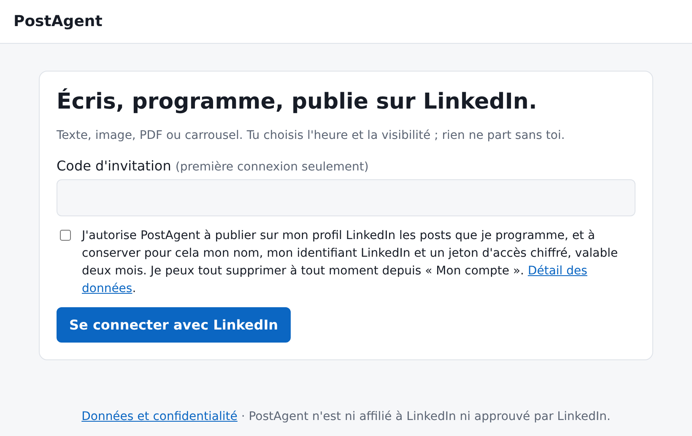
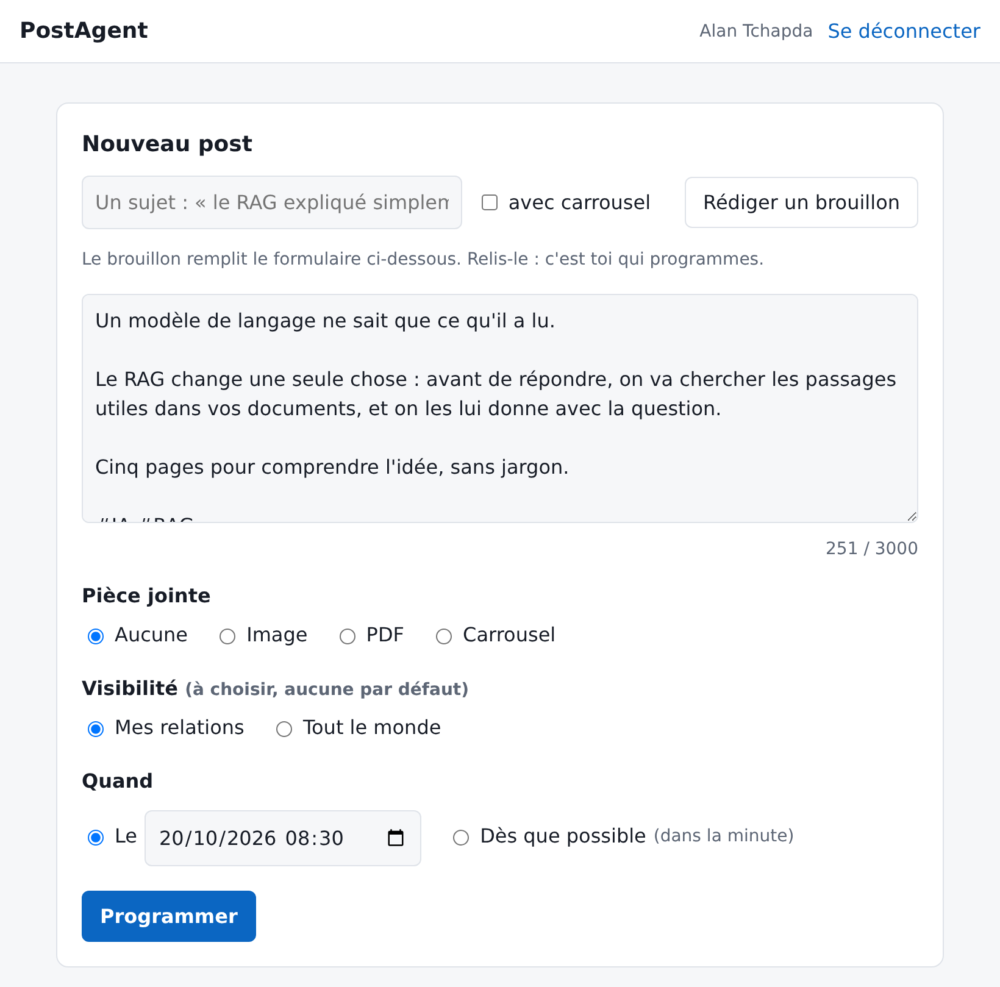
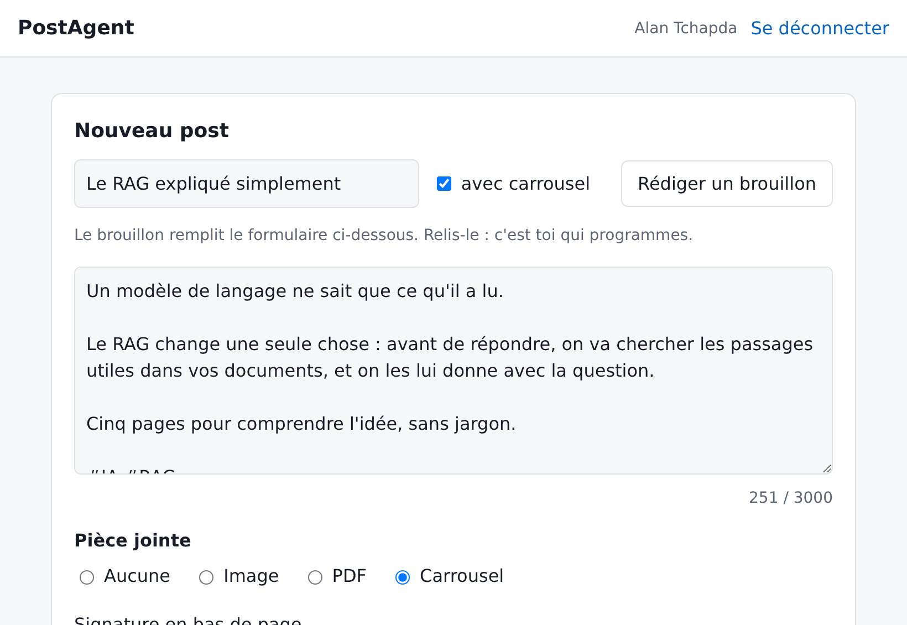
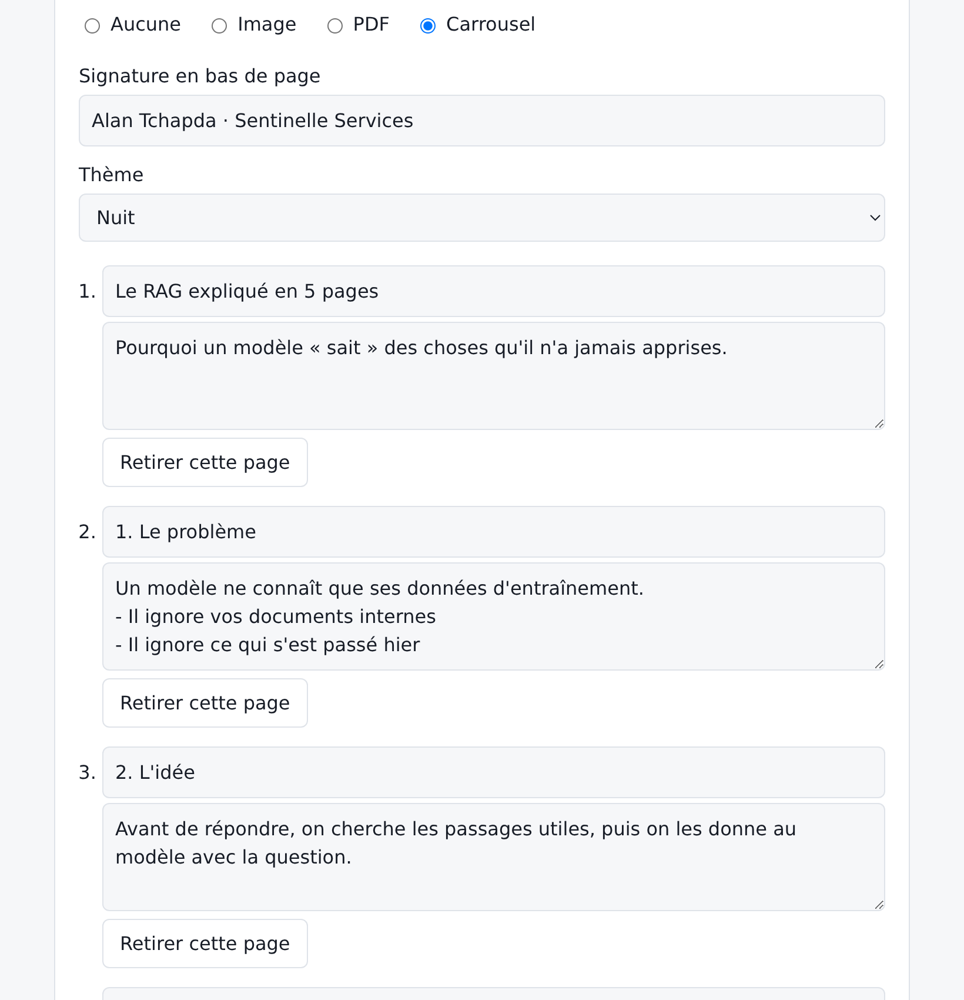
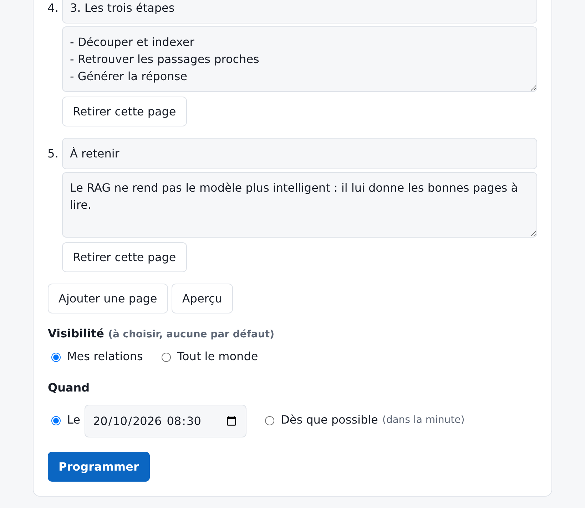
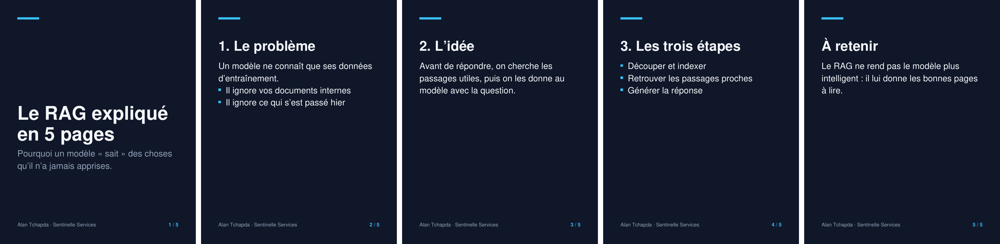
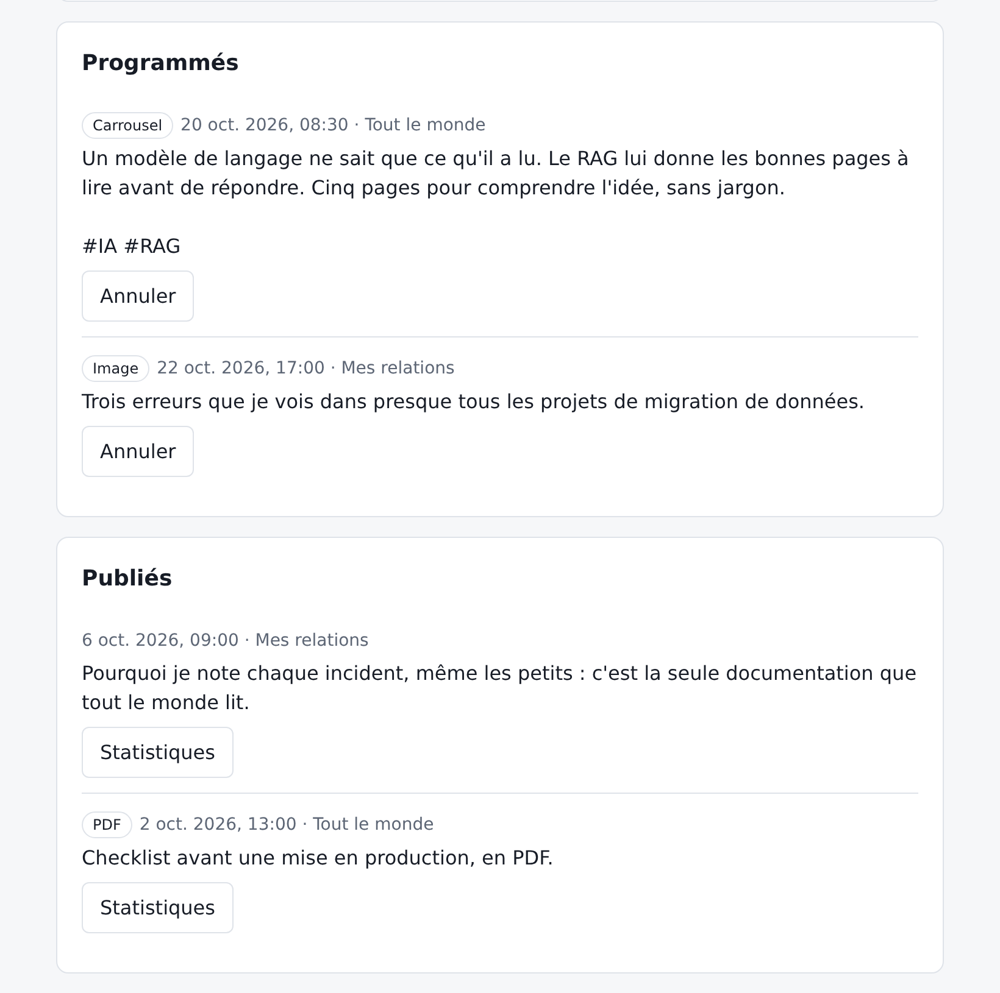
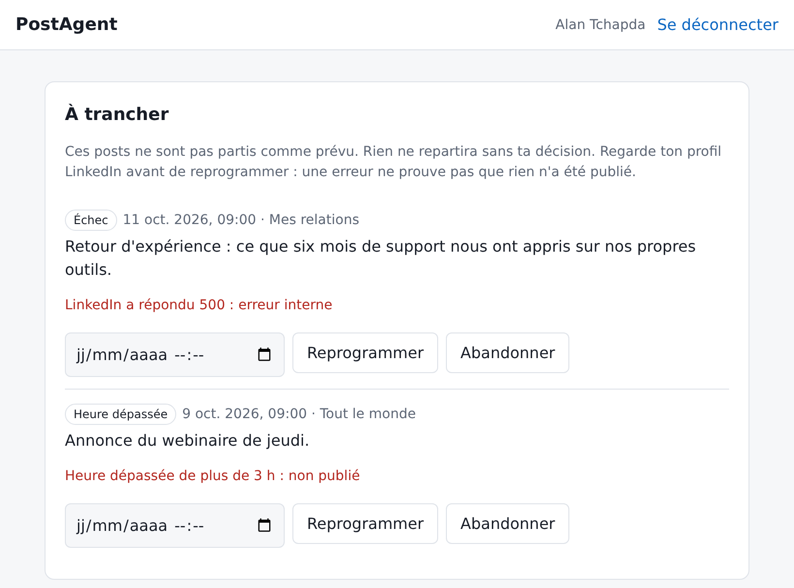
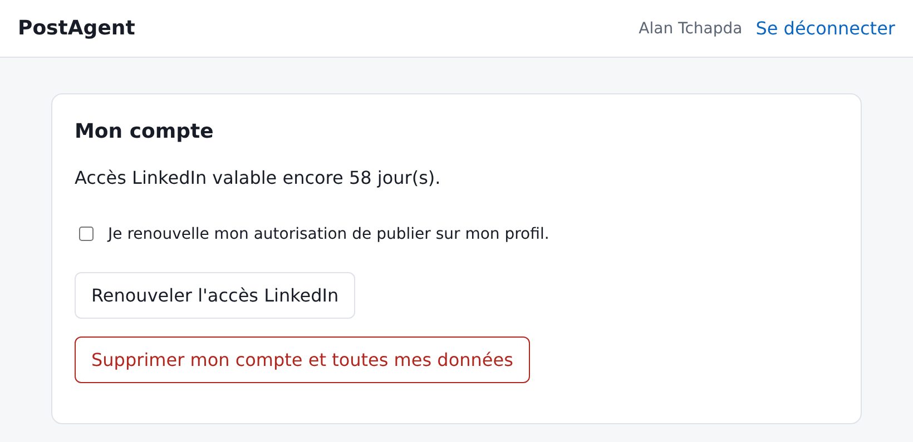

# Guide d'utilisation — PostAgent

PostAgent t'aide à publier sur LinkedIn : tu donnes un sujet, tu relis un
brouillon, tu choisis l'heure, et le post part tout seul. Ce guide suit
l'ordre dans lequel tu te serviras de l'outil.

Les captures viennent d'une installation de démonstration, avec des posts
d'exemple. L'adresse de ta propre installation t'est donnée par la personne
qui t'invite.

> PostAgent ne publie jamais rien que tu n'aies programmé toi-même, avec
> une visibilité que tu as choisie.

## 1. Avant de commencer

Il te faut trois choses :

- un **compte LinkedIn** ;
- l'**adresse** de PostAgent ;
- un **code d'invitation**, pour ta toute première connexion seulement.

Rien à installer : un navigateur suffit, sur ordinateur comme sur téléphone.

## 2. Se connecter

*L'écran d'accueil, avant la connexion.*

1. Saisis ton **code d'invitation**. Les fois suivantes, laisse ce champ
   vide.
2. **Coche la case** d'autorisation après l'avoir lue. Elle dit exactement
   ce que PostAgent garde de toi : ton nom, ton identifiant LinkedIn et un
   accès chiffré, valable deux mois.
3. Clique sur **Se connecter avec LinkedIn**. LinkedIn te demande de
   confirmer, puis te ramène dans PostAgent, connecté.

PostAgent ne connaît jamais ton mot de passe LinkedIn : tu le saisis chez
LinkedIn, pas ici.

| Message | Ce qu'il veut dire |
|---|---|
| « Le consentement est nécessaire » | la case n'était pas cochée |
| « Inscription sur invitation : le code est absent ou faux » | première connexion sans le bon code |
| « Lien de connexion expiré ou déjà utilisé » | tu as mis plus de dix minutes, ou rechargé la page de retour : recommence |

## 3. Écrire et programmer un post

*Le formulaire « Nouveau post », rempli.*

1. **Écris ton texte.** Le compteur sous la zone donne la longueur telle que
   LinkedIn la mesurera ; la limite est de 3 000. Écris en texte simple :
   les astérisques et autres symboles de mise en forme s'afficheraient tels
   quels.
2. **Pièce jointe** : aucune, une image, un PDF ou un carrousel (voir les
   sections 5 et 6).
3. **Visibilité** : choisis *Mes relations* ou *Tout le monde*. Aucune
   n'est cochée d'avance, exprès : c'est toi qui décides, à chaque post.
4. **Quand** : une date et une heure, ou *Dès que possible* — le post part
   alors dans la minute.
5. Clique sur **Programmer**. Le post apparaît dans la liste « Programmés ».

Un post programmé ne se modifie pas : pour le corriger, annule-le et
refais-le. Une fois publié, LinkedIn ne permet pas non plus de le changer
par ce chemin : il faut le supprimer depuis ton profil et le republier.

## 4. Faire rédiger un brouillon

Tu n'as pas à partir d'une page blanche.

*Un sujet, la case « avec carrousel », et le brouillon remplit le formulaire.*

1. En haut du formulaire, **écris ton sujet** en une phrase : « le RAG
   expliqué simplement », « trois erreurs dans une migration de données ».
   Plus il est précis, meilleur est le brouillon.
2. Coche **avec carrousel** si tu veux aussi des pages à feuilleter.
3. Clique sur **Rédiger un brouillon** et patiente quelques secondes.
4. **Relis tout.** Le brouillon est un point de départ : il ne connaît ni
   ton expérience, ni tes chiffres. Ajoute ce qui est à toi, retire ce qui
   sonne faux.
5. Choisis la visibilité et la date, puis **Programmer**, comme pour un
   post écrit à la main.

Tant que tu n'as pas cliqué sur *Programmer*, rien n'est enregistré et rien
ne partira.

| Message | Ce qu'il veut dire |
|---|---|
| « La rédaction assistée n'est pas activée » | ton installation n'a pas cette option ; écris ton post à la main |
| « Ce sujet a été refusé par le modèle » | reformule le sujet |
| « Sujet trop long » | 600 caractères au plus : donne un sujet, pas le post entier |

## 5. Composer un carrousel

Un carrousel est une suite de pages que tes lecteurs font défiler. C'est le
format qui retient le plus longtemps l'attention pour expliquer une idée.

*L'éditeur : une ligne par page, un titre et un texte.*

1. Dans **Pièce jointe**, choisis **Carrousel**.
2. Renseigne la **signature** affichée en bas de chaque page, et le
   **thème** (nuit ou clair).
3. Remplis chaque page : un **titre** court, un **texte** de deux ou trois
   lignes. La première page est la couverture.
4. **Ajouter une page** ou **Retirer cette page** : de 2 à 10 pages. Quatre
   à six est un bon nombre.
5. Clique sur **Aperçu** : tu vois le document exact qui sera publié.

*Sous les pages : aperçu, visibilité, date, puis « Programmer ».*

Pour qu'une page se lise bien :

- une idée par page ;
- un titre de moins de 40 caractères ;
- une ligne qui commence par un tiret et une espace devient une **puce** ;
  trois puces au plus ;
- **pas d'emoji** dans les pages : ils s'afficheraient comme des points
  d'interrogation. Dans le texte du post, ils fonctionnent ;
- un texte trop long est réduit automatiquement, puis coupé : regarde
  l'aperçu.

*Le carrousel de l'exemple, tel qu'il sera publié.*

## 6. Joindre une image ou un PDF

- **Image** : JPG, PNG ou GIF.
- **PDF** : donne-lui un **titre**, il s'affiche au-dessus du document sur
  LinkedIn.
- Dans les deux cas, **1,5 Mo au plus** pour l'instant. Au-delà, réduis le
  fichier avant de le déposer.

La vidéo n'est pas encore prise en charge.

## 7. Suivre ses posts

*Les posts programmés et les posts publiés.*

- **Programmés** : ce qui partira, dans l'ordre. Le bouton **Annuler**
  retire un post tant qu'il n'est pas parti.
- **Publiés** : ce qui est en ligne, avec sa date réelle de publication.
  **Statistiques** affiche les vues, réactions, commentaires et partages —
  si LinkedIn a accordé cette possibilité à ton installation. Sinon, le
  message « Statistiques indisponibles » l'explique ; elles restent
  visibles sur LinkedIn.

## 8. Trancher un post qui n'est pas parti

Quand un post ne part pas comme prévu, PostAgent **ne réessaie jamais tout
seul**. Il te le montre et attend ta décision.

*La zone « À trancher » n'apparaît que s'il y a quelque chose à décider.*

| Étiquette | Ce qui s'est passé | Que faire |
|---|---|---|
| **Échec** | LinkedIn a refusé ou n'a pas répondu ; la raison est écrite en rouge | regarde ton profil, puis reprogramme ou abandonne |
| **Heure dépassée** | le post avait plus de trois heures de retard ; il n'a pas été publié, pour ne pas partir à contretemps | choisis une nouvelle date, ou abandonne |
| **Resté en cours** | la publication a été interrompue au mauvais moment | **le post a peut-être été publié** : vérifie ton profil avant tout |

**Avant de reprogrammer, ouvre toujours ton profil LinkedIn.** Une erreur
ne prouve pas que rien n'est parti. Reprogrammer un post déjà en ligne le
publierait une seconde fois.

Si la raison est « Accès LinkedIn expiré », renouvelle d'abord ton accès
(section suivante), puis reprogramme.

## 9. Mon compte

*En bas de page : l'échéance de ton accès, son renouvellement, la suppression du compte.*

### Renouveler son accès, tous les deux mois

LinkedIn limite chaque autorisation à **deux mois**. Passé ce délai, tes
posts programmés ne peuvent plus partir.

- PostAgent affiche le nombre de jours restants, et te prévient en haut de
  page quand il en reste moins de sept.
- Pour renouveler : coche la case, clique sur **Renouveler l'accès
  LinkedIn**. Si tu es déjà connecté à LinkedIn dans ce navigateur, c'est
  l'affaire d'un clic.

Renouvelle **avant** l'échéance : c'est plus simple, et aucun post n'est
manqué.

### Supprimer son compte

**Supprimer mon compte et toutes mes données** efface immédiatement ton
accès LinkedIn, tes posts programmés et ta session. C'est définitif.

Les posts déjà publiés restent sur LinkedIn : ils sont à toi et se
suppriment depuis ton profil. Tu peux aussi retirer l'autorisation de
PostAgent depuis les réglages de LinkedIn.

## 10. Questions fréquentes

| Question | Réponse |
|---|---|
| Un bandeau dit « Mode démonstration » | la publication est verrouillée sur cette installation : tu peux tout essayer, rien ne partira vers LinkedIn |
| Mon post est-il parti à l'heure ? | regarde « Publiés » : la date affichée est celle de la publication réelle |
| Puis-je programmer plusieurs posts ? | oui, autant que tu veux ; espace-les plutôt que de les grouper |
| Puis-je publier sur la page de mon entreprise ? | non : PostAgent publie sur ton profil personnel |
| Quelqu'un d'autre voit-il mes posts programmés ? | non : chaque membre ne voit que les siens |
| PostAgent lit-il mes messages ou mon réseau ? | non : il ne peut que publier ce que tu programmes |
| J'ai fermé la page pendant la rédaction du brouillon | rien n'est perdu ni enregistré : recommence |
| Le texte de mon carrousel est coupé | raccourcis-le, ou ajoute une page ; vérifie avec « Aperçu » |

## 11. Bons réflexes

- **Relis toujours** un brouillon : c'est ton nom qui signe.
- Commence en **Mes relations** le temps de prendre l'outil en main.
- Programme tes posts **quelques jours à l'avance**, et jette un œil à la
  zone « À trancher » de temps en temps.
- Renouvelle ton accès **dès l'avertissement**.
- En cas de doute sur un post, **ton profil LinkedIn fait foi**.
